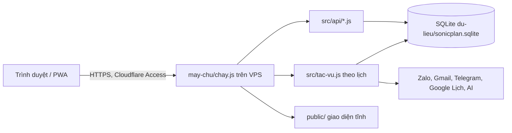

# Kiến trúc Sonicplan (tóm tắt)

Cập nhật: 22/11/2026. Chi tiết thư mục ở `README.md`, mục "Cấu trúc".

- Bản chạy thật: VPS `tlu-prod-web-02`, `plan.sonicapp.top`, mã ở `~/apps/sonicplan`. `may-chu/chay.js` bọc mã Worker (`src/`) chạy trên Node, dùng lớp giả D1 (`may-chu/lop-d1.js`) trên SQLite.
- CSDL: một tệp SQLite; lược đồ từ `migrations/` (áp tự động lúc khởi động, mỗi tệp một lần, ghi ở bảng `_migrations`).
- Nhiều khách: mọi bảng có `to_chuc_id`, mọi truy vấn của người dùng lọc theo cột này.
- Giao diện: mô-đun ES trong `public/` (không bước dựng), `public/trang/*.js` mỗi tệp một mục. Kéo thả thẻ: `public/keo-tha.js` (Pointer Events, chạy cả cảm ứng).
- Trang Việc: `public/trang/viec.js` vẽ cột; `cot-trang-thai.js` suy cột trạng thái; `tab-viec.js` xử lý tab xem đã lưu; API ở `src/api/viec.js`.
- D1 `tro-ly-rieng` trong `wrangler.jsonc` là bản cũ, không phục vụ người dùng thật.
